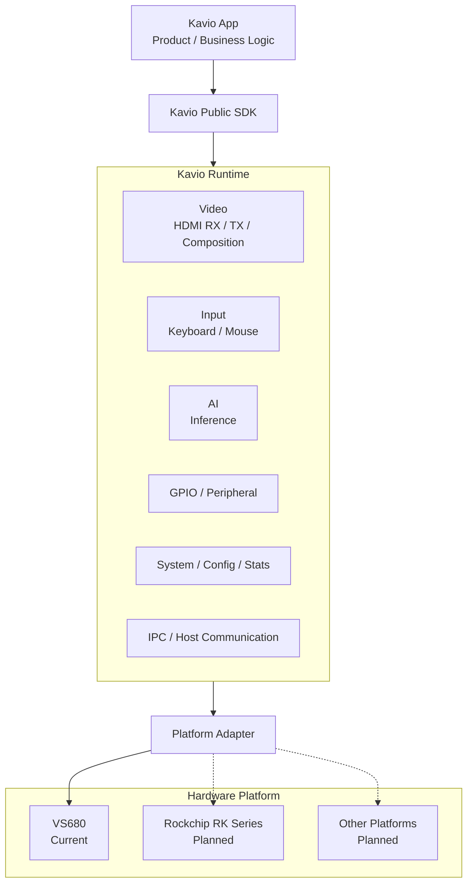
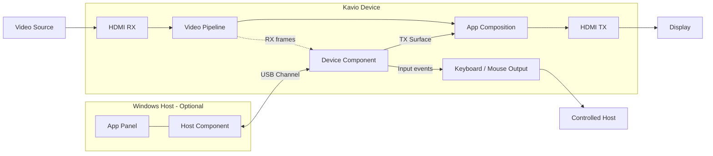

# Kavio

[简体中文](README.md) | [English](README_EN.md)

> **Kavio — Hardware as Software.**  
> **让硬件像软件一样开发。**

Kavio 是一套面向整机产品的硬件抽象与应用软件平台。它将具体芯片、板卡和外设提供的硬件能力转化为稳定、统一的软件能力，让软件开发者可以围绕产品功能开发，而不需要直接处理 SoC 厂商 SDK、Linux 设备节点、驱动差异或板级接口。

Kavio 的产品愿景是：**屏蔽硬件特性，降低硬件平台开发门槛，让整机能力以软件接口和 App 的方式被开发、组合和复用。**

对于 App 开发者，HDMI RX/TX、外置键盘鼠标、AI 推理、GPIO、设备状态、Host/Device 通信等能力都应表现为统一的 Kavio 能力接口。具体能力在不同 SoC、不同板卡上的初始化、驱动调用、资源管理和差异适配由 Kavio Platform 负责。

从工程边界上看：**硬件平台是 Kavio 的依赖，而不是 App 的依赖。**

当前 Kavio 的首个完整适配平台是 **VS680**。后续计划继续适配 **Rockchip RK 系列**及其他硬件平台，使上层 App 尽可能保持相同的开发模型和接口。

---

## 1. 项目定位

传统嵌入式整机开发通常要求应用开发者同时理解：

- SoC 厂商媒体 SDK；
- HDMI RX/TX 驱动和视频管线；
- NPU / AI Runtime；
- GPIO、I2C、SPI 等板级接口；
- USB HID、BLE、2.4G 等输入输出链路；
- 共享内存、IPC、进程生命周期；
- Windows 与设备之间的通信协议；
- 不同硬件平台之间完全不同的 API 和资源模型。

这些工作会让大量产品功能与具体硬件深度耦合，也使同一套软件迁移到另一颗 SoC 时需要重新开发大量底层代码。

Kavio 希望把这部分复杂度集中到平台层：

```text
Product / App Logic
        │
        ▼
Kavio Public SDK
        │
        ▼
Kavio Runtime & Capability Layer
        │
        ▼
Platform Adapter
        │
        ├── VS680
        ├── Rockchip RK Series      planned
        └── Other SoCs / Boards     planned
        │
        ▼
Vendor BSP / Drivers / Hardware
```

对上层软件来说，关注的是“我要一帧 HDMI RX 图像”“我要创建一个 TX 图层”“我要执行一次 AI 推理”“我要控制一个 GPIO”，而不是这些能力在某颗芯片上具体由哪个驱动、哪个设备节点或哪个厂商 API 实现。

## 2. 设计目标

### 2.1 屏蔽硬件差异

Kavio Platform 负责吸收不同硬件平台之间的差异，包括但不限于：

| 能力域 | Kavio 目标抽象 |
| --- | --- |
| HDMI RX | 输入状态、视频模式、帧获取、采样 |
| HDMI TX | 输出模式、图层、合成、位置与 Alpha |
| 输入设备 | 键盘、鼠标及不同物理输出链路 |
| AI | 模型加载、推理任务、硬件加速后端 |
| GPIO | GPIO 生命周期、方向、读写与功能映射 |
| 媒体能力 | 解码、缩放、像素格式和硬件媒体资源 |
| 系统能力 | 设备状态、运行统计、配置和资源管理 |
| Host 通信 | Windows 与 Device 之间的统一业务通道 |

不同平台可以有不同的底层实现，但 App 不应直接依赖这些实现。

### 2.2 Hardware as Software

**Hardware as Software** 是 Kavio 的核心产品理念：把底层硬件能力转化为可编程、可组合、可复用的软件能力。

Kavio 不只提供单个硬件驱动封装，而是提供完整的 App Runtime、SDK、Host/Device 通信、配置、打包和生命周期管理。

目标是让软件开发者在 Kavio 框架内完成大部分整机产品功能：

```text
硬件能力
   ↓
Kavio Capability
   ↓
App 组合与业务逻辑
   ↓
完整产品功能
```

例如，一个 App 可以组合 HDMI RX、AI 推理、TX Overlay 和键鼠输出，形成“识别画面 → 做出判断 → 在屏幕显示结果 → 控制目标设备”的完整闭环，而不需要分别对接每一项底层硬件。

### 2.3 保持稳定的 App 开发模型

Kavio App 应只依赖公开 SDK。平台迁移由 Kavio Platform Adapter 承担，尽量避免把 SoC 专用逻辑带入 App。

这意味着：

- App 不直接调用 VS680、RK 等厂商 SDK；
- App 不直接访问平台私有驱动和设备节点；
- App 不依赖 Kavio Runtime 内部进程和 IPC 实现；
- App 使用统一的数据类型、生命周期和错误模型；
- 新硬件平台优先通过 Platform Adapter 接入，而不是修改每个 App。

这里强调的是**接口和开发模型的可移植性**。不同 SoC 的性能、支持格式和硬件资源仍可能不同，Kavio 会通过能力查询和运行时状态向 App 暴露实际可用能力。

## 3. 整体架构

<p align="center">
  
</p>




### 平台层

负责具体硬件实现，包括驱动、厂商 SDK、媒体资源、NPU、GPIO 和板级配置等。

### Runtime / Capability Layer

把平台能力组织成统一的运行时服务，并负责：

- 资源生命周期；
- 进程与 Session；
- IPC 和共享内存；
- 能力状态；
- App 隔离；
- 配置和运行统计。

### SDK

面向 App 暴露稳定 API。App 只依赖公开 SDK，不依赖 Runtime 私有实现。

### App

实现真正的产品功能。一个 App 可以只运行在设备端，也可以带有 Windows Host Component 和 App Panel。

## 4. Kavio App 模型

一个 Kavio App 至少包含 Device Component：

```text
Kavio App
├── Device Component                 required
│   ├── Native C++ executable
│   └── or Python script
│
├── Host Component                   optional
│   └── Windows x64 DLL
│
├── App Configuration                optional
├── App Panel                        optional
└── Package metadata / icon
```

### Device Component

运行在 Kavio 设备上，是 App 的主要业务进程。当前公开 Device SDK 已提供：

- HDMI RX 视频帧读取；
- HDMI TX BGRA Surface；
- Runtime Data；
- Keyboard / Mouse Input；
- USB Channel；
- App Configuration；
- Runtime Stats。

AI、GPIO 以及更多硬件能力属于 Kavio 的平台能力方向，公开 App API 会随着对应能力稳定后逐步纳入 SDK。

### Host Component

运行在 Windows 上的可选 x64 DLL，适合实现：

- Windows API 和系统信息；
- 文件访问和图片解码；
- 自定义 App Panel；
- 与其他 Windows 软件集成；
- 通过 USB Channel 与 Device Component 双向通信。

## 5. 典型视频与交互架构



Kavio App 可以把视频输入、视频输出、Windows 数据和输入控制组合为一个业务闭环，而底层 HDMI、USB 和输入设备实现由平台负责。

## 6. 当前平台状态

### 已适配硬件平台

| 平台 | 状态 | 说明 |
| --- | --- | --- |
| VS680 | 已支持 | 当前 Kavio 的首个完整硬件适配平台 |
| Rockchip RK 系列 | 规划中 | 通过 Platform Adapter 接入统一 Kavio 能力模型 |
| 其他 SoC / Board | 规划目标 | 根据产品需求继续扩展 |

### 当前公开 App SDK 能力

| 能力 | 当前公开接口 |
| --- | --- |
| HDMI RX | 启用/关闭 RX、读取最新帧、查询 RX 状态 |
| HDMI TX | 创建 BGRA8888 Surface、提交帧、位置、有效区域、Alpha、层级 |
| Input | 键盘和鼠标事件 |
| Host / Device 通信 | App 专用 USB Channel |
| Runtime Data | RX、TX、输入等运行状态 |
| App Configuration | 标准配置请求与响应 |
| Runtime Stats | 运行统计查询 |
| Device App | C++17 / Python |
| Windows Host | x64 DLL / C ABI / App Panel |

> 公开 SDK 能力与 Kavio 平台的长期能力范围不是同一个概念。平台能力会先完成硬件抽象和 Runtime 集成，再以稳定接口逐步开放给 App。

## 7. 仓库结构

完整 Kavio 工程按职责划分为：

```text
<repository>/
├── README.md                   # 中文项目总览
├── README_EN.md                # English overview
├── kavio_platform/             # 设备侧 Runtime、硬件能力与平台适配
├── kavio_win/                  # Windows 侧 Kavio Runtime / App Host
├── kavio_sdk/                  # App 公共开发 SDK
└── kavio_app/                  # Demo Apps、构建与 .kap 打包工具
```

各模块的依赖方向应保持清晰：

```text
App ──> Public SDK ──> Kavio Runtime ──> Platform Adapter ──> Hardware
```

App 不应反向依赖 `kavio_platform` 或 `kavio_win` 的私有实现。

## 8. SDK 入口

### Device SDK

```text
kavio_sdk/device/
```

支持 C++ 和 Python Device Component。

详细说明：[`kavio_sdk/device/README.md`](kavio_sdk/device/README.md)

### Host SDK

```text
kavio_sdk/host/
```

用于开发 Windows x64 Host Component。

详细说明：[`kavio_sdk/host/README.md`](kavio_sdk/host/README.md)

SDK 总览：[`kavio_sdk/README.md`](kavio_sdk/README.md)

## 9. Demo App

推荐按以下顺序理解 Kavio App 开发：

| 目标 | Demo |
| --- | --- |
| Device 生命周期、RX/TX/Input | `demo_rx_tx` |
| Host ↔ Device 双向通信 | `demo_communication` |
| App Panel、图片传输、TX 联动 | `demo_panel_image` |
| Python Device Component | `demo_metrics_panel` |
| Windows 虚拟显示与视频传输 | `demo_virtual_hdmi` |

详细说明：`kavio_app/README.md`

## 10. 快速开始

### 10.1 构建 Device SDK

```bash
cd kavio_sdk/device
./build.sh -r
```

Native App 通过生成的 CMake package 链接 Device SDK，不直接编译 SDK 私有源码。

### 10.2 构建 Device Demo

```bash
cd kavio_app/demo_rx_tx/device
./build.sh -r
```

Python Demo：

```bash
cd kavio_app/demo_metrics_panel/device
./build.sh
```

### 10.3 构建 Host Component

包含 `host/` 的 App 使用 Visual Studio 构建 Windows x64 DLL。

### 10.4 生成 Kavio App Package

Kavio App 安装包使用 `.kap` 后缀，含义为 **Kavio App Package**。

```bash
cd kavio_app
python3 kavio_app.py list
python3 kavio_app.py status demo_communication
python3 kavio_app.py package demo_communication
```

生成文件位于：

```text
kavio_app/<app>/dist/
```

## 11. Public / Internal 边界

App 开发者应只依赖公开 SDK，不应依赖：

- Kavio Runtime 内部进程结构；
- SoC 厂商 SDK；
- 平台私有驱动封装；
- 内部视频管线实现；
- 底层 USB 协议；
- `kavio_sdk/device/src/internal`；
- 未声明为 Public API 的数据结构。

Kavio 的跨平台能力依赖这个边界：**平台差异必须收敛在 Kavio 内部，而不是扩散到 App。**

## 12. 版本与能力差异

当前 Device SDK 版本定义位于：

```text
kavio_sdk/device/include/kavio/KavioSdkVersion.h
```

设备 Runtime 在建立 Device Session 时校验 SDK 是否满足最低接入版本。

不同硬件平台可能具有不同的：

- 最大视频分辨率与帧率；
- 像素格式；
- AI 算力与支持模型；
- 媒体编解码能力；
- GPIO 数量和映射；
- 可用内存与带宽；
- 并发资源上限。

这些差异应通过 Kavio 的能力查询、Runtime Data 和平台配置表达，而不应通过 App 直接识别具体 SoC 型号后走私有代码路径。

## 13. 项目原则

Kavio 的长期工程原则可以概括为：

1. **硬件能力统一抽象**：上层使用能力，不使用芯片厂商接口。
2. **平台差异集中适配**：新增硬件优先修改 Platform Adapter，不修改业务 App。
3. **Hardware as Software**：把硬件能力转化为可编程、可组合、可复用的软件能力。
4. **公开接口稳定**：App 只依赖 Public SDK 和公开 Package Contract。
5. **能力真实可查询**：不假设所有平台完全相同，由 Runtime 告知实际可用资源。
6. **Host / Device 一体化**：需要 Windows 能力时，通过统一 Host Component 模型与设备协同。
7. **可部署、可管理**：App 使用统一生命周期、配置、日志、运行状态和 `.kap` 安装包。

> **Kavio — Hardware as Software.**  
> **让硬件像软件一样开发。**

Kavio 希望让软件开发者以统一的软件模型使用整机硬件能力，把硬件平台差异留在 Kavio 内部。
