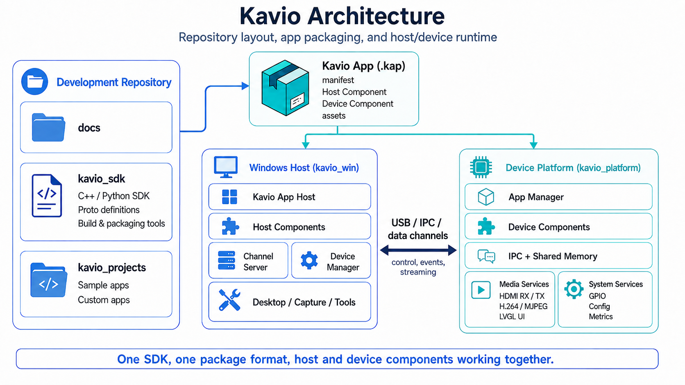
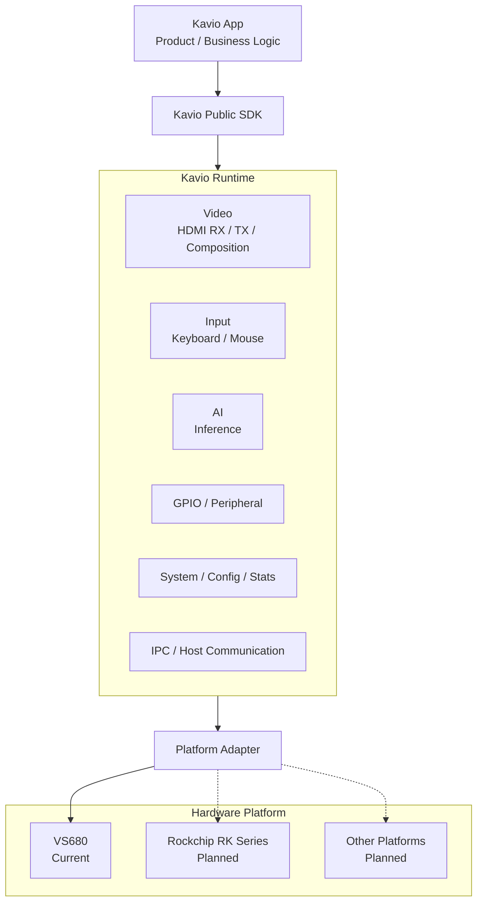
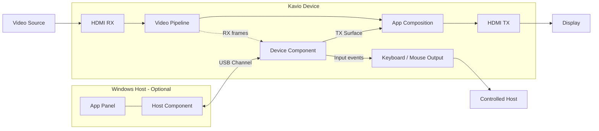

# Kavio

[简体中文](README.md) | [English](README_EN.md)

> **Kavio — Hardware as Software.**  
> **Develop hardware like software.**

Kavio is a hardware abstraction and application software platform for complete hardware products. It turns capabilities provided by specific SoCs, boards, and peripherals into stable, consistent software capabilities, allowing software developers to focus on product behavior instead of SoC vendor SDKs, Linux device nodes, board-specific drivers, or platform-specific APIs.

Kavio's product vision is to **hide hardware-specific complexity, lower the barrier to hardware-platform development, and make device capabilities programmable, composable, and reusable through software interfaces and Apps.**

From an App developer's point of view, capabilities such as HDMI RX/TX, external keyboard and mouse I/O, AI inference, GPIO, runtime state, and Host/Device communication should be presented through a consistent Kavio capability model. Platform-specific initialization, drivers, resource management, and vendor APIs are handled by Kavio Platform.

As an engineering boundary: **the hardware platform is a dependency of Kavio, not a dependency of the App.**

The first fully adapted Kavio hardware platform is **VS680**. Future platform work is planned for **Rockchip RK series** and other SoCs, with the goal of keeping the upper-layer App model and APIs as consistent as possible.

---

## 1. Project positioning

A conventional embedded product often requires application developers to understand and integrate:

- SoC vendor media SDKs;
- HDMI RX/TX drivers and video pipelines;
- NPU and AI runtimes;
- GPIO, I2C, SPI, and other board interfaces;
- USB HID, BLE, and 2.4G input/output paths;
- shared memory, IPC, and process lifecycle;
- Windows-to-device communication;
- platform-specific APIs and resource models.

This creates strong coupling between product logic and the selected hardware platform, and makes migration to another SoC expensive.

Kavio moves this complexity into the platform layer:

```text
Product / App Logic
        │
        ▼
Kavio Public SDK
        │
        ▼
Kavio Runtime & Capability Layer
        │
        ▼
Platform Adapter
        │
        ├── VS680
        ├── Rockchip RK Series      planned
        └── Other SoCs / Boards     planned
        │
        ▼
Vendor BSP / Drivers / Hardware
```

Upper-layer software should express intent such as "give me an HDMI RX frame", "create a TX layer", "run an AI inference", or "set this GPIO". It should not need to know which vendor API, driver, or device node implements that capability on a particular SoC.

## 2. Design goals

### 2.1 Abstract hardware differences

Kavio Platform is responsible for absorbing differences across hardware platforms, including but not limited to:

| Capability domain | Kavio abstraction target |
| --- | --- |
| HDMI RX | input state, video mode, frame access, sampling |
| HDMI TX | output mode, layers, composition, position, alpha |
| Input | keyboard, mouse, and physical output transports |
| AI | model loading, inference jobs, hardware acceleration backend |
| GPIO | lifecycle, direction, read/write, functional mapping |
| Media | decode, scale, pixel formats, hardware media resources |
| System | device state, runtime statistics, configuration, resource management |
| Host communication | unified application channel between Windows and Device |

The implementation may differ by platform, but Apps should not depend on those implementation details.

### 2.2 Hardware as Software

**Hardware as Software** is Kavio's core product idea: turn low-level hardware capabilities into programmable, composable, and reusable software capabilities.

Kavio is more than a collection of driver wrappers. It provides an App Runtime, SDK, Host/Device communication, configuration, packaging, and lifecycle management.

The intended product-development model is:

```text
Hardware Capability
        ↓
Kavio Capability
        ↓
App Composition & Business Logic
        ↓
Complete Product Feature
```

For example, an App can combine HDMI RX, AI inference, TX overlay, and keyboard/mouse output into a complete loop: **observe → infer → render → control**, without integrating each hardware subsystem independently.

### 2.3 Keep the App model stable

Kavio Apps should depend only on the public SDK. Hardware migration belongs in the Kavio Platform Adapter instead of the App.

In practice:

- Apps do not call VS680, Rockchip, or other vendor SDKs directly;
- Apps do not access platform-private drivers or device nodes;
- Apps do not depend on Kavio Runtime internal IPC or process layout;
- Apps use common data types, lifecycle rules, and error models;
- new hardware platforms should be added through Platform Adapters instead of per-App changes.

The goal is **API and development-model portability**. Hardware performance and supported formats can still differ between SoCs. Kavio exposes actual capabilities through runtime state and capability queries rather than pretending that every platform is identical.

## 3. Architecture

<p align="center">
  
</p>




### Platform layer

Implements concrete hardware support using vendor BSPs, drivers, media resources, NPU runtimes, GPIO mappings, and board configuration.

### Runtime and capability layer

Turns platform capabilities into managed runtime services, including:

- resource lifecycle;
- process and session management;
- IPC and shared memory;
- capability state;
- App isolation;
- configuration and runtime statistics.

### SDK

Exposes stable public APIs to Apps. Apps depend on the SDK instead of Runtime internals.

### App

Implements product behavior. An App can run only on the device or can also include a Windows Host Component and App Panel.

## 4. Kavio App model

Every Kavio App contains at least a Device Component:

```text
Kavio App
├── Device Component                 required
│   ├── Native C++ executable
│   └── or Python script
│
├── Host Component                   optional
│   └── Windows x64 DLL
│
├── App Configuration                optional
├── App Panel                        optional
└── Package metadata / icon
```

### Device Component

Runs on the Kavio device and implements the main application logic. The current public Device SDK exposes:

- HDMI RX frame access;
- HDMI TX BGRA surfaces;
- Runtime Data;
- keyboard and mouse input events;
- USB Channel;
- App Configuration;
- Runtime Stats.

AI, GPIO, and additional hardware services are part of the broader Kavio platform capability direction. Public App APIs are added as those capability contracts become stable.

### Host Component

An optional Windows x64 DLL. Typical responsibilities include:

- Windows APIs and system information;
- file access and image decoding;
- custom App Panels;
- integration with other Windows software;
- bidirectional communication with the Device Component through USB Channel.

## 5. Typical video and interaction architecture



A Kavio App can combine video input, video output, Windows-side data, and input control in one application while Kavio owns the underlying HDMI, USB, and input-device implementations.

## 6. Platform status

### Hardware platforms

| Platform | Status | Description |
| --- | --- | --- |
| VS680 | Supported | First fully adapted Kavio hardware platform |
| Rockchip RK series | Planned | Intended to use the same Kavio capability model through a Platform Adapter |
| Other SoCs / boards | Planned direction | Added according to product requirements |

### Current public App SDK capabilities

| Capability | Current public interface |
| --- | --- |
| HDMI RX | enable/disable RX, read latest frame, query RX state |
| HDMI TX | BGRA8888 surfaces, frame submission, position, valid region, alpha, z-order |
| Input | keyboard and mouse events |
| Host / Device communication | App-specific USB Channel |
| Runtime Data | RX, TX, input, and device state |
| App Configuration | standard configuration requests and responses |
| Runtime Stats | runtime statistics |
| Device App | C++17 / Python |
| Windows Host | x64 DLL / C ABI / App Panel |

> The public SDK surface is not identical to the full long-term platform capability set. Hardware capabilities are integrated into the platform and Runtime first, then exposed to Apps through stable public contracts.

## 7. Repository layout

The complete Kavio project is organized by responsibility:

```text
<repository>/
├── README.md                   # Chinese project overview
├── README_EN.md                # English project overview
├── kavio_platform/             # Device Runtime, hardware capabilities, platform adapters
├── kavio_win/                  # Windows-side Kavio Runtime / App Host
├── kavio_sdk/                  # Public App development SDK
└── kavio_app/                  # Demo Apps, build tools, and .kap packaging
```

The dependency direction should remain:

```text
App ──> Public SDK ──> Kavio Runtime ──> Platform Adapter ──> Hardware
```

Apps should not depend directly on private implementation details in `kavio_platform` or `kavio_win`.

## 8. SDK entry points

### Device SDK

```text
kavio_sdk/device/
```

Supports C++ and Python Device Components.

See [`kavio_sdk/device/README.md`](kavio_sdk/device/README.md).

### Host SDK

```text
kavio_sdk/host/
```

Used to develop Windows x64 Host Components.

See [`kavio_sdk/host/README.md`](kavio_sdk/host/README.md).

SDK overview: [`kavio_sdk/README.md`](kavio_sdk/README.md)

## 9. Demo Apps

Recommended demos by goal:

| Goal | Demo |
| --- | --- |
| Device lifecycle, RX/TX/Input | `demo_rx_tx` |
| Bidirectional Host ↔ Device communication | `demo_communication` |
| App Panel, image transfer, TX integration | `demo_panel_image` |
| Python Device Component | `demo_metrics_panel` |
| Windows virtual display and video transport | `demo_virtual_hdmi` |

See `kavio_app/README.md` for App-specific documentation.

## 10. Quick start

### 10.1 Build the Device SDK

```bash
cd kavio_sdk/device
./build.sh -r
```

Native Apps link the generated CMake package and do not compile SDK private sources directly.

### 10.2 Build a Device demo

```bash
cd kavio_app/demo_rx_tx/device
./build.sh -r
```

Python demo:

```bash
cd kavio_app/demo_metrics_panel/device
./build.sh
```

### 10.3 Build a Host Component

Apps containing `host/` use Visual Studio to build a Windows x64 DLL.

### 10.4 Build a Kavio App Package

Kavio App packages use the `.kap` extension, meaning **Kavio App Package**.

```bash
cd kavio_app
python3 kavio_app.py list
python3 kavio_app.py status demo_communication
python3 kavio_app.py package demo_communication
```

Packages are written to:

```text
kavio_app/<app>/dist/
```

## 11. Public / Internal boundary

App developers should depend only on public SDKs and should not depend on:

- Kavio Runtime internal process layout;
- SoC vendor SDKs;
- platform-private driver wrappers;
- internal video-pipeline implementation;
- low-level USB protocols;
- `kavio_sdk/device/src/internal`;
- data structures not declared as Public API.

This boundary is essential to Kavio's cross-platform architecture: **platform differences must stay inside Kavio instead of leaking into Apps.**

## 12. Versions and capability differences

The current Device SDK version is defined in:

```text
kavio_sdk/device/include/kavio/KavioSdkVersion.h
```

The Device Runtime verifies that the SDK meets the minimum supported version when a Device Session is created.

Different hardware platforms may have different:

- maximum video resolutions and frame rates;
- pixel formats;
- AI performance and supported model types;
- media codec capabilities;
- GPIO counts and mappings;
- memory and bandwidth;
- concurrent resource limits.

These differences should be represented through Kavio capability queries, Runtime Data, and platform configuration. Apps should not branch on a specific SoC model and call private platform code.

## 13. Project principles

Kavio's long-term engineering principles are:

1. **Unify hardware capabilities** — upper layers consume capabilities, not vendor APIs.
2. **Centralize platform adaptation** — new hardware belongs in Platform Adapters, not in every App.
3. **Hardware as Software** — turn hardware capabilities into programmable, composable, and reusable software capabilities.
4. **Keep public interfaces stable** — Apps depend on the Public SDK and public package contracts.
5. **Expose real capabilities** — Runtime reports what a platform can actually provide instead of assuming identical hardware.
6. **Unify Host and Device development** — Windows-side functionality integrates through the Host Component model.
7. **Make Apps deployable and manageable** — common lifecycle, configuration, logging, runtime state, and `.kap` packaging.

> **Kavio — Hardware as Software.**  
> **Develop hardware like software.**

Kavio lets software developers use complete device capabilities through a consistent software model while keeping hardware-platform differences inside Kavio.
