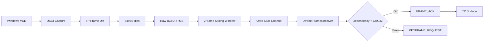

# demo_virtual_hdmi

## 1. 功能说明

`demo_virtual_hdmi` 展示一个包含 Native Device Component、Windows Host Component、App Panel 和第三方虚拟显示驱动资源的完整 Kavio App。

运行后：

1. Host Component 管理 `VirtualDrivers/Virtual-Display-Driver` 提供的 `VDD by MTT` 虚拟显示器；
2. Windows 将虚拟显示器配置为 720×720@60，并作为扩展桌面使用；
3. Host 使用 DXGI Desktop Duplication 捕获虚拟显示器画面；
4. Host 将画面按 64×64 tile 生成 I/P 差分帧，并在每个 tile 上选择 Raw BGRA 或 RLE 编码；
5. 图像通过 Kavio USB Channel 发送到 Device Component；
6. Device 完成依赖检查、tile 解码和整帧 CRC32 校验后更新 720×720 BGRA8888 TX Surface；
7. Device 可以通过 `KEYFRAME_REQUEST` 请求新的 I 帧恢复同步；
8. App Panel 显示 VDD、捕获、传输、ACK、压缩和设备端组帧状态。

这个 Demo 适合作为虚拟显示器采集、Host/Device 双端流控和 App Panel 状态监控的参考实现。

## 2. 构建 Device Component

### 环境要求

- CMake 3.16 或更高版本；
- 支持 C++17 的编译器；
- 仓库中存在 `kavio_sdk/device`；
- 目标设备为 AArch64，或者提供对应交叉编译工具链。

### Release 构建

```bash
cd kavio_app/demo_virtual_hdmi/device
./build.sh -r
```

交叉编译：

```bash
./build.sh -r --toolchain /path/to/aarch64-toolchain.cmake
```

该 Demo 默认检查最终可执行文件是否为 AArch64。只有已经通过其他方式确认目标架构时才使用：

```bash
./build.sh -r --skip-arch-check
```

构建产物：

```text
kavio_app/demo_virtual_hdmi/output/device/demo_virtual_hdmi
```

清理 Device 构建：

```bash
./build.sh --clean
```

## 3. 构建 Host Component

### 环境要求

```text
Visual Studio 2015 或更高版本
Platform:      x64
Configuration: Debug 或 Release
Toolset:       v140
Windows SDK:   8.1
运行系统:      Windows 10 x64 或更高版本
```

使用 Visual Studio 打开：

```text
kavio_app/demo_virtual_hdmi/host/VirtualHdmiStream.sln
```

Host 工程通过相对路径引用：

```text
kavio_sdk/host/include
```

Host Build 会执行 `stage_vdd_package.cmd`，并把待打包文件暂存到：

```text
kavio_app/demo_virtual_hdmi/output/host/host.dll
kavio_app/demo_virtual_hdmi/output/host/vdd/
```

`output/host/vdd/` 至少需要包含：

```text
MttVDD.inf
MttVDD.dll
mttvdd.cat
vdd_settings.xml
VDD_LICENSE.txt
```

如果 `host/vdd_package/` 缺少完整的签名 VDD 文件，可在联网的 Windows 构建机执行：

```bat
cd kavio_app\demo_virtual_hdmi\host
fetch_vdd_package.cmd
```

默认获取并校验 `25.7.23` 的 x64 签名驱动包，同时生成 `VDD_SHA256.txt`。

## 4. 检查和打包

Device 和 Host 都构建完成后：

```bash
cd kavio_app
python3 kavio_app.py status demo_virtual_hdmi
python3 kavio_app.py package demo_virtual_hdmi
```

最终安装包输出到：

```text
kavio_app/demo_virtual_hdmi/dist/demo_virtual_hdmi-2.0.0.kap
```

`status` 会检查 App 图标以及清单中声明的 Device/Host 运行产物。Host 目录中的 `vdd/` 会随 Host Component 一起进入 `.kap`。

## 5. 目录结构

```text
demo_virtual_hdmi/
├── common/
│   └── VirtualHdmiProtocol.h
├── device/
│   ├── CMakeLists.txt
│   ├── build.sh
│   ├── FrameReceiver.cpp
│   ├── FrameReceiver.h
│   └── main.cpp
├── host/
│   ├── VirtualHdmiStream.sln
│   ├── VirtualHdmiStreamHost.vcxproj
│   ├── HostComponent.cpp
│   ├── VirtualDisplayCapture.cpp
│   ├── VirtualDisplayCapture.h
│   ├── VirtualDisplayControl.cpp
│   ├── VirtualDisplayControl.h
│   ├── fetch_vdd_package.cmd
│   ├── fetch_vdd_package.ps1
│   ├── stage_vdd_package.cmd
│   └── vdd_package/
└── package/
    ├── kavio_package.json
    ├── schema_description.json
    └── icon.png
```

`common/VirtualHdmiProtocol.h` 是 Host 和 Device 共用的图像传输协议定义。

## 6. VDD 配置与控制

虚拟显示器由公开签名的 VirtualDrivers VDD 提供，设备实例和显示器名称为：

```text
Device:  Root\MttVDD
Monitor: VDD by MTT
```

随 App 使用的 `vdd_settings.xml` 配置为：

```text
Display count: 1
Resolution:    720 x 720
Refresh rate: 60 Hz
Color:        RGB / 8-bit SDR
HardwareCursor: false
```

运行时配置路径：

```text
C:\VirtualDisplayDriver\vdd_settings.xml
```

App Panel 中的 `Install / configure VDD` 会完成驱动文件校验、配置写入、设备创建/配置、显示器数量设置和 Windows 显示模式设置。需要管理员权限的操作通过系统 `rundll32.exe` 重新加载 `host.dll` 并调用：

```text
KavioVirtualDisplayAdmin
```

管理员入口退出码：

```text
0 = 成功
1 = 失败
2 = 参数错误
3 = 成功，但需要重启 Windows
```

如果系统已经存在可用的 `Root\MttVDD`，Host 会保留其所有权信息，并在移除 Kavio 配置时恢复对应配置和显示器数量。

## 7. 图像传输协议

协议版本：

```text
v1
```

固定图像参数：

```text
Resolution: 720 x 720
Format:     BGRA8888
Tile:       64 x 64
Max FPS:    60
Window:     2 frames
```

帧类型：

- `IFrame`：发送完整画面的全部 tile，`base_frame_id = 0`；
- `PFrame`：只发送相对于 baseline 发生变化的 tile，并携带 `base_frame_id`。

每个 tile 独立选择：

```text
Raw BGRA
RLE BGRA32
```

一帧的消息顺序为：

```text
FRAME_BEGIN
  -> TILE...
  -> FRAME_END
  -> FRAME_ACK
```

关键规则：

- Host 使用 `2-frame sliding window`，最多允许 2 帧已提交但尚未累计 ACK；
- 窗口满时直接跳过当前捕获帧，不建立待发送 FIFO；
- Host 每 90 个已发送帧主动生成一个 I 帧；
- Device 只接受 `PFrame.base_frame_id == last_good_frame_id` 的 P 帧；
- Device 遇到依赖断裂、CRC/解码失败、组帧超时或接收队列溢出时发送 `KEYFRAME_REQUEST`；
- `KEYFRAME_REQUEST` 最快每 200 ms 重试一次；
- Host 收到关键帧请求、负 ACK、Channel 重连或单帧发送失败时，下一张有效帧使用 I 帧建立 baseline；
- `FRAME_ACK` 表示 Device 已完成该帧重建和 CRC32 校验，并累计释放 `frame_id <= ACK.frame_id` 的发送窗口槽位。

### 分块传输结构



```text
Windows VDD
   |
   v
DXGI Capture
   |
   v
I/P Frame Diff
   |
   +--> 64x64 changed tiles
          |
          +--> Raw BGRA
          |
          +--> RLE BGRA32
                 |
                 v
        FRAME_BEGIN / TILE / FRAME_END
                 |
                 v
          2-frame Sliding Window
                 |
                 v
           Kavio USB Channel
                 |
                 v
          Device FrameReceiver
                 |
        dependency + CRC32 check
          |                  |
          | success          | failure
          v                  v
      FRAME_ACK       KEYFRAME_REQUEST
          |
          v
      TX Surface
```

## 8. DXGI 捕获与 TX 输出

Host 的 `VirtualDisplayCapture` 按以下顺序定位并捕获虚拟显示器：

1. 使用 `QueryDisplayConfig` 按 `VDD by MTT` 或 monitor id `MTT1337` 定位活动显示器；
2. 必要时使用 `EnumDisplayDevices` 查找显示设备；
3. 把 GDI 显示名称映射到 DXGI output；
4. 在对应 GPU adapter 上创建 D3D11 device；
5. 使用 `IDXGIOutput1::DuplicateOutput` 捕获；
6. 读取 720×720 BGRA8888 staging texture。

发生 `DXGI_ERROR_ACCESS_LOST`、显示模式切换或 VDD 重载时，Host 会重新枚举捕获目标。

Device 使用 `FrameReceiver` 维护最近一次通过 CRC 校验的 baseline。完整帧通过独立 TX writer 写入 720×720 BGRA8888 TX Surface；如果显示写入速度低于接收速度，只保留最新待显示帧，避免显示队列持续增长。

## 9. App Panel

Host Component 提供 App Panel，主要操作：

```text
Install / configure VDD
Remove Kavio VDD setup
Open display settings
```

状态区包括：

- VDD 安装与配置状态；
- DXGI capture 状态；
- Kavio Channel 和 Device App 状态；
- Stream target 和 Windows VDD desktop mode；
- `Capture FPS / Push FPS / ACK FPS`；
- Push bandwidth；
- I/P 帧计数；
- `KEYFRAME_REQUEST` 次数；
- `In-flight / window`；
- 窗口满时跳过的捕获帧数；
- tile 数量、RLE/Raw 比例、压缩前后字节数；
- Host 构帧/发送耗时和 Device 组帧耗时；
- VDD 管理操作的 Win32 错误信息。

VDD 安装和移除在独立线程执行，不阻塞图像发送线程和 Panel UI。

## 10. 运行验证

1. 构建 Device Component 和 Host Component，并生成 `.kap`；
2. 安装并启动 App；
3. 打开 App Panel，执行 `Install / configure VDD`；
4. 确认 Windows 出现 `VDD by MTT`，分辨率为 720×720@60；
5. 将窗口或鼠标移动到虚拟显示器，确认设备 TX 同步显示；
6. 确认 `Capture FPS / Push FPS / ACK FPS` 持续更新；
7. 确认静态画面下 P 帧发送 tile 数明显下降；
8. 制造 Channel 重连或帧依赖异常，确认 Device 能通过 `KEYFRAME_REQUEST` 恢复；
9. 执行 `Remove Kavio VDD setup`，确认 VDD 配置按当前所有权状态正确清理或恢复。

## 12. 常用修改入口

| 目标 | 文件 |
| --- | --- |
| 修改协议、分辨率、tile 参数 | `common/VirtualHdmiProtocol.h` |
| 修改 Host 帧率、I/P 帧和滑动窗口 | `host/HostComponent.cpp` |
| 修改 DXGI 捕获 | `host/VirtualDisplayCapture.*` |
| 修改 VDD 安装、配置和显示模式 | `host/VirtualDisplayControl.*` |
| 修改 Device 组帧和 CRC | `device/FrameReceiver.*` |
| 修改 Device TX 写入和重同步 | `device/main.cpp` |
| 修改 VDD 固定配置 | `host/vdd_package/vdd_settings.xml` |
| 修改 App Panel | `host/HostComponent.cpp` |
